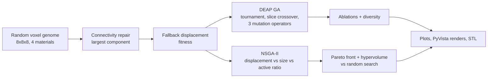

# Xenobot-Inspired Soft Robot Evolution

[](https://github.com/ayushishringi/xenobot-exercise/actions/workflows/ci.yml)

This project explores simple voxel-based soft robot bodies inspired by Xenobots. Each robot is represented as a 3D grid of voxels, where each voxel can be empty, passive material, or active material.

## Project features

The project includes:

- random voxel genome generation
- voxel counting and material statistics
- connectivity repair using the largest connected component
- placeholder and fallback displacement-style fitness functions
- a basic evolutionary algorithm using DEAP
- diagnostic plots and voxel visualizations
- PyVista 3D voxel visualizations
- density ablation experiments
- a documented VoxCraft-sim build/integration attempt
- NSGA-II multi-objective evolutionary search

## How to run

Install dependencies:

```bash
pip install -r requirements.txt
```

## Start Jupyter:
```bash
jupyter notebook
```

## Main notebooks:
```
- `notebooks/milestone1_notebook.ipynb`
- `notebooks/milestone2_notebook.ipynb`
- `notebooks/milestone3_notebook.ipynb`
- `notebooks/milestone4_notebook.ipynb`
```

## Project structure
```
src/                  Source code for representation, fitness, evolution, simulation adapters, and visualization
notebooks/            Milestone notebooks
results/              Generated plots, robot images, and experiment outputs
milestone3_results/   VoxCraft-sim build log and ablation outputs
report/               Final report draft and final report files
```

## VoxCraft-sim note

A real VoxCraft-sim integration was attempted in Google Colab with a T4 GPU. The main voxcraft-sim launcher built successfully, but the required vx3_node_worker executable failed to compile in the available CUDA/Boost environment. Because of this, the project documents the integration attempt and uses a fallback displacement-style simulator for local experiments.

The fallback simulator is not claimed to be real VoxCraft-sim physics. It is used to test the evolutionary pipeline, ablation study, and multi-objective optimization workflow.

## Pipeline



## Results

The numbers below are copied from [results/analysis_results.txt](results/analysis_results.txt). The script that printed that file is not in this repo, so treat them as recorded outputs, not as something `make` reproduces. All fitness values come from the fallback simulator, not real physics.

| Experiment | Recorded result |
|---|---|
| NSGA-II vs random search (5,200 evaluations) | Hypervolume 127,360.19 vs 59,802.08 (2.13×); Pareto front sizes 50 vs 36 |
| Ablation, fitness at gen 200 (mean ± std, 3 seeds) | baseline 345.10 ± 2.03; no_crossover 323.31 ± 0.69; no_connectivity 342.02 ± 2.69; random_selection 189.45 ± 13.14; single_material 196.96 ± 3.32; no_mutation 194.87 ± 3.08 |
| Mann-Whitney U vs baseline | No condition significant (every p ≥ 0.10; with 3 seeds per condition the smallest possible p is 0.10) |
| Diversity | Fell below 10% of its initial value at generation 78 |
| COM height vs displacement | Correlation 0.597 |
| Fitness evaluation time | 2.24 s for a 512³ grid (first size over 1 s) |

## Tests

```bash
pip install -r requirements.txt ruff==0.8.4
ruff check .         # src/ and tests/
python -m pytest -v  # representation, connectivity repair, fitness
```

CI runs both on every push and pull request.

## Limitations

- Fitness comes from a hand-written displacement proxy. VoxCraft-sim did not build (see above), so nothing here measures real soft-body locomotion.
- The ablations use 3 seeds per condition, which is too few for the rank test to reach significance.
- The analysis script behind `results/analysis_results.txt` is not committed.


